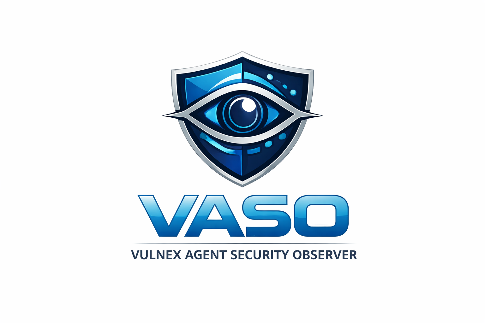

<p align="center">
  
</p>

# VASO

**VULNEX Agent Security Observer** — agent-agnostic security scanner for AI agent deployments.

<!-- badges -->

## Overview

VASO scans AI agent frameworks, interactive coding agents, desktop AI apps, and MCP server configurations for security misconfigurations, malicious code, and known threats. It runs 311 checks across 23 agents (10 autonomous frameworks + 9 interactive coding agents + 4 agentic desktop apps) plus MCP-server scanning, using AST-based static analysis (not regex) for accurate results without ever executing scanned code.

## Installation

VASO is distributed from GitHub. The npm name `vaso` is held by an unrelated package; do not install that.

```bash
# One-liner (Linux / macOS / WSL) — recommended
curl -fsSL https://raw.githubusercontent.com/vulnex/vaso/main/install.sh | bash

# Or install the prebuilt release tarball directly with npm
npm install -g https://github.com/vulnex/vaso/releases/download/v1.0.0/vaso-1.0.0.tgz
```

Requires Node.js 20+.

> **Note:** install the release **tarball**, not `npm install -g github:vulnex/vaso#<tag>`. On npm 11+, the global git-dependency install path mishandles the package and leaves an unusable install; the prebuilt tarball has no build step and installs cleanly.

### Build from source

For development, or to install from a local checkout:

```bash
git clone https://github.com/vulnex/vaso.git
cd vaso
npm install
npm run build           # produces dist/cli.js
npm link                # optional: put `vaso` on PATH globally
```

Without `npm link`, run the CLI directly with `./bin/vaso`. Other useful scripts: `npm run dev` (rebuild on change), `npm test` (unit), `npm run test:e2e`, `npm run lint` (`tsc --noEmit`).

## Quick Start

```bash
# Scan all detected AI agents
vaso scan

# List installed agents
vaso detect

# Scan MCP server configs
vaso mcp scan
```

Exit code 1 means critical findings were detected — use this to fail CI pipelines.

## Remote / Fleet Scanning

VASO can scan remote hosts over SSH or from pre-collected snapshots — no Node.js required on the target. A static Go probe binary is pushed on demand, runs once, and is removed. The probe matching the remote's OS/arch is fetched and SHA-256-verified automatically on first use, then cached under `~/.vaso/probe/` — so remote scanning works straight away whether you installed or cloned VASO, with no Go toolchain needed. See [`doc/network-scanning-guide.md`](doc/network-scanning-guide.md) for the full workflow.

```bash
# Scan one remote host
vaso scan --host root@10.0.0.5

# Scan a fleet (parallel, with retry on transient SSH failures)
vaso scan --inventory hosts.yaml --parallel 20 --ssh-retries 2

# Collect snapshots once, re-scan offline against new baselines
vaso scan --inventory hosts.yaml --save-snapshot ./snapshots/
vaso scan --snapshot ./snapshots/prod-agent-01.json --diff
```

## Commands

| Command | Description |
|---------|-------------|
| `vaso scan` | Scan installed agents and report findings |
| `vaso detect` | List detected agent installations |
| `vaso fix` | Auto-remediate fixable findings |
| `vaso visualize` | Emit USecVisLib config files for visualization |
| `vaso update` | Fetch signed threat-feed updates (published at least monthly — see [SECURITY.md](SECURITY.md#threat-feed-updates)) |
| `vaso mcp scan` | Scan MCP server configurations |
| `vaso mcp list` | List discovered MCP servers |
| `vaso skill audit <path>` | Audit a skill directory before installing |
| `vaso ext list` | List loaded user plugins (drop-in `~/.vaso/plugins/*.js`) |
| `vaso ext info <name>` | Show a user plugin's details |

See [doc/user-guide.md](doc/user-guide.md) for full option reference.

## Supported Agents

**Autonomous frameworks**

- **OpenClaw** — `~/.openclaw`, `~/.clawdbot`, `~/.moltbot`, `/etc/openclaw`
- **NanoClaw** — `~/.nanoclaw.env`, `~/.config/nanoclaw/`
- **PicoClaw** — `~/.picoclaw/`
- **IronClaw** — `~/.ironclaw/` (TOML, gRPC gateway)
- **Nanobot** — `~/.nanobot/` (Discord/Slack bot framework)
- **ZeroClaw** — `~/.zeroclaw/` (Composio integration)
- **NemoClaw** — `~/.nemoclaw/` (NVIDIA NIM, GPU isolation)
- **Hermes** — `~/.hermes/` (API-server gateway model)
- **Lyrie** — `~/.lyrie/` (Bun turborepo, Rust Shield Layer 1, 10-channel gateway)
- **Atomic Agent** — `~/.atomic-agent/` or `$ATOMIC_AGENT_STATE_DIR` (config.json + .env; local-first operator agent with approval ladder, MCP, skills, Telegram/Discord channels, HTTP service)

**Coding agents**

- **Claude Code** — `~/.claude/`, `~/.claude.json`, project-level `.claude/`
- **Claude Desktop** — `~/Library/Application Support/Claude/claude_desktop_config.json` (macOS), `%APPDATA%\Claude\claude_desktop_config.json` (Windows); MCPB extensions
- **ChatGPT Desktop** — `/Applications/ChatGPT.app` + `~/Library/Application Support/com.openai.chat/`; preferences plist (macOS only)
- **Codex** — `~/.codex/{config.toml,auth.json}`
- **OpenCode** — XDG paths (`$XDG_CONFIG_HOME/opencode/`, `$XDG_DATA_HOME/opencode/`)
- **Gemini CLI** — `~/.gemini/` (settings.json + OAuth credential files)
- **Qwen Code** — `~/.qwen/` (multi-provider auth: OpenAI / Anthropic / Gemini / Dashscope / Bailian)
- **GitHub Copilot CLI** — `~/.copilot/` + workspace `.mcp.json` + `.github/lsp.json`
- **Cursor CLI/IDE** — `~/.cursor/` (cli-config.json, mcp.json, permissions.json, sandbox.json, hooks.json) + IDE user settings
- **Windsurf / Devin Desktop** — `~/.codeium/windsurf/`, `~/.config/devin/`, editor user-data dirs (both generations)
- **Devin CLI** — `~/.config/devin/` (config.json, mcp_config.json) + `~/.local/share/devin/credentials.toml`

**Agentic desktop apps**

- **Meta Muse** — `/Applications/Muse.app` + `com.meta.endo` preferences (macOS; initial coverage)
- **Perplexity Comet** — `/Applications/Comet.app` + Chromium profile (extension inventory, session data)

**MCP servers** — Claude Desktop, Claude Code, Cursor, Windsurf, Devin CLI, Atomic Agent, Nanobot, PicoClaw, Lyrie, VS Code, project-level configs

## Security Checks

311 checks organized into 17 categories:

| Category | IDs | Count | Description |
|----------|-----|-------|-------------|
| Configuration | CFG-001–024 | 24 | Gateway binding, API keys, TLS, permissions, sandbox, NemoClaw hardening |
| Skill Code | SKL-001–013 | 13 | AST data-flow, obfuscation, eval/exec, reverse shells, workspace symlink escape |
| IOC Matching | IOC-001–008 | 8 | C2 IPs, malicious domains, typosquatting, file hashes |
| Network | NET-001–005 | 5 | Gateway exposure, WebSocket origins, proxy bypass |
| Runtime | RUN-001–005 | 5 | LaunchAgents, cron, Docker socket, VS Code trojans |
| Policy | POL-001–005 | 5 | DM policy, tool policy, sandbox compliance |
| MCP Server | MCP-001–035 | 35 | Transport security, credential exposure, tool injection, toxic flows, rug pull, stdio shell-c, world-writable command paths, streamable-HTTP origin pinning, tool-description poisoning, cross-server tool-name collision, slash-command overlap, remote-server-without-auth, filesystem sensitive-path scope, vulnerable/rolled-back version, config drift, untrusted installer source, env-dump tool, long-lived token, hardcoded prompt-injection directives in tool output, obfuscated/encoded server source; opt-in npm package source resolution; OWASP MCP Top 10 coverage mapping |
| Advisory | ADV-001–005 | 5 | Vulnerability/CVE detection with version awareness |
| Coding Agent | CC, CD, CG, CDX, OPC, GEM, QC, CUR, GHC, WS, DEV, MM, PC | 117 | Claude Code (12), Claude Desktop (10), ChatGPT Desktop (6), Codex (10), OpenCode (12), Gemini CLI (11), Qwen Code (10), Cursor (14), GitHub Copilot CLI (9), Windsurf/Devin Desktop (8), Devin CLI (10), Meta Muse (3), Perplexity Comet (2) — sandbox/approval policy, plaintext credentials, MCP pinning, broad allow rules, memory-file secrets, transport security |
| Agent-Specific | OC, NC, IC, NB, ZC, LY, HM, AT | 94 | Per-framework checks (OpenClaw 6, NanoClaw 5, IronClaw 14, Nanobot 12, ZeroClaw 16, Lyrie 20, Hermes 10, Atomic Agent 11) |

Server-only checks (gateway/network/runtime concepts) are automatically excluded for coding agents to avoid false positives — interactive coding CLIs have a different threat model than autonomous server agents.

## Output Formats

```bash
vaso scan                              # Terminal (default) — color-coded with score
vaso scan --format json -o report.json # JSON — structured, machine-readable
vaso scan --format sarif -o results.sarif  # SARIF — GitHub Code Scanning compatible
vaso scan --format markdown -o report.md   # Markdown — for PR comments
vaso scan --format html -o report.html     # HTML — standalone report
vaso scan --format csv -o results.csv      # CSV — one row per finding, for SIEM ingestion
vaso scan --format junit -o results.xml    # JUnit XML — for CI test-result reporters
```

Markdown and SARIF reports also include **OWASP coverage mappings** — both the [OWASP MCP Top 10](https://owasp.org/) and the [OWASP Agentic AI Top 10](https://github.com/precize/Agentic-AI-Top10-Vulnerability) — showing which checks address each risk and flagging the risks a static scanner cannot cover (e.g. AAI014 Alignment Faking).

## Scoring

VASO produces a 0–100 score with a letter grade (A–F) per agent. Critical findings deduct 12 points, warnings deduct 5.

When multiple agents are detected, the **headline score is worst-case** — the lowest-scoring agent — because a security posture is gated by its weakest agent, and a mean would grow more reassuring as clean agents are added, hiding a critical exposure in a large fleet. The mean is still reported as a secondary **Fleet average** for trend tracking.

## CI/CD Integration

### GitHub Action

The simplest path — drop one step into any workflow:

```yaml
- uses: vulnex/vaso@v1
  with:
    fail-on: critical          # or warning, info, none
    format: sarif              # sarif, json, markdown, html, terminal
    # output: vaso-results.sarif  (default: vaso-results.<ext>)
    # agent: claude-code           (default: scan all detected agents)
    # version: v1.0.0              (release tag)
    # upload-sarif: 'true'          (auto-uploads to Code Scanning)
```

The action installs the requested VASO version, runs the scan, and (when `format: sarif`) uploads the report to GitHub Code Scanning. Exit codes follow `--fail-on`: a `critical` threshold (default) fails the build only on critical findings; pass `none` to never fail.

### Manual workflow

```yaml
- name: Install VASO
  run: npm install -g https://github.com/vulnex/vaso/releases/download/v1.0.0/vaso-1.0.0.tgz

- name: Run VASO scan
  run: vaso scan --format sarif -o results.sarif --fail-on critical

- name: Upload SARIF
  if: always()
  uses: github/codeql-action/upload-sarif@v3
  with:
    sarif_file: results.sarif
```

## Differential Scanning

Track security posture over time:

```bash
vaso scan --save-baseline    # Save after a clean scan
vaso scan --diff             # Compare against baseline on subsequent scans
```

## Visualizations

`vaso visualize` emits [USecVisLib](https://github.com/vulnex/usecvislib) config files (TOML by default; JSON/YAML available) for three diagram types: per-installation **attack tree**, per-installation **privilege gradient** (architecture-specific — NemoClaw GPU isolation, Claude Code MCP transport, etc.), and a whole-scan **component diagram**.

```bash
# Run a fresh scan and write the bundle
vaso visualize -o ./vis/

# Or replay a saved scan result
vaso scan -f json -o scan.json
vaso visualize -i scan.json -o ./vis/

# Render with USecVisLib (commands also listed in the bundle README)
usecvis -m 0 -i ./vis/openclaw-attack-tree.toml -o tree -f png
usecvis -m 6 -i ./vis/openclaw-privilege-gradient.toml -o gradient -f png
usecvis -m 7 -i ./vis/topology.toml -o topology -f png
```

VASO never bundles, sidecars, or calls a USecVisLib server — the contract between the two tools is a static config file. Users render externally with whichever USecVisLib mode (CLI, REST, or MCP) they prefer.

## Zero-Dependency Quick Scan

For environments without Node.js, run 5 critical checks with pure Bash:

```bash
bash bin/vaso-quick.sh
```

## Plugin System

VASO supports user plugins in `~/.vaso/plugins/`. Plugins can add custom checks, output formatters, and agent adapters. See [doc/development-guide.md](doc/development-guide.md) for the plugin API.

## Documentation

- [User Guide](doc/user-guide.md) — full command reference and configuration
- [Network Scanning Guide](doc/network-scanning-guide.md) — SSH, inventory, snapshot, and fleet workflows
- [Development Guide](doc/development-guide.md) — contributing and plugin development
- [Testing Guide](doc/testing-guide.md) — test suite and CI setup

## License

Apache-2.0 — see [LICENSE](LICENSE).
